# 🚀 Awesome LLM Reinforcement Learning & RLHF (2026) 🤖

  <strong>A curated list of elite SaaS platforms, post-training frameworks, and open-source libraries for LLM Reinforcement Learning from Human Feedback (RLHF), Preference Optimization (DPO, KTO, GRPO), Reward Modeling, and Self-Hosted AI Alignment.</strong>

  
  
  
  
  
  

---

## 📌 Table of Contents

- [🌐 Sector Overview & Market Dynamics](#-sector-overview--market-dynamics)
- [🏢 SaaS & Hosted Alignment Platforms](#-saas--hosted-alignment-platforms)
- [💻 Open-Source Repositories & Libraries](#-open-source-repositories--libraries)
- [📈 Star History](#-star-history)
- [💖 Support & Contributing](#-support--contributing)
- [⚠️ Disclaimer](#️-disclaimer)

---

## 🌐 Sector Overview & Market Dynamics

The AI data labeling and RLHF alignment sector is estimated at **$2.5B–$4.5B in 2026** (scaling to over **$18B–$57B by the 2030s** at an estimated 20%–25% CAGR), driven by frontier LLM post-training, reasoning models, and agent evaluation demands. Market dynamics are **moderately concentrated at the frontier tier** (where heavyweight leaders like Scale AI and Surge AI dominate multi-hundred-million-dollar lab contracts due to critical high-skill annotator moats), yet **increasingly fragmented across the mid-market and tooling layer** with specialized programmatic labeling, managed workforce boutiques, and open-source self-hosted alignment frameworks challenging vendor lock-in.

---

## 🏢 SaaS & Hosted Alignment Platforms

| Platform | Company Size (Valuation / Revenue) | Pricing | Free Tier / Trial Limits | Key Focus & Overview |
| :--- | :--- | :--- | :--- | :--- |
| **[Scale AI](https://scale.com/)** | **~$29B valuation** (~$2B ARR in 2025; Meta 49% stake at $14.3B) | Starting at ~$0.05/labeling unit (Rapid/Data Engine self-serve); Enterprise contracts scale from $50,000+ | Free tier for Scale Nucleus dataset management (individual/academic use; capped data rows & model zoo queries); Rapid tier historically includes 200–1,000 free starter labeling units. | Enterprise annotation, RLHF data, and evaluation services. Strategic neutrality risk following Meta's 49% acquisition. |
| **[Surge AI](https://www.surge.ai/)** | **~$15B–$25B valuation** (~$1.2B–$1.4B ARR; bootstrapped until 2025) | Custom enterprise quotes only (typically tailored for engagements exceeding $50K–$100K; dynamic pricing based on domain expertise and SLAs) | No free tier or public self-serve trial; enterprise sales-gated evaluation pilots only. | The RLHF data heavyweight and neutral choice for frontier labs (OpenAI, Anthropic, Google); elite annotator pools specializing in complex reasoning, coding, and alignment. |
| **[Snorkel Flow](https://snorkel.ai/)** | **~$3.5B valuation** (~$375M ARR; Series E Sep 2026) | Starting at ~$50,000–$60,000/year (AWS Marketplace base enterprise software license / application unit) | No self-serve free forever tier; sales-provisioned enterprise POCs / private trial sandboxes upon request. | Programmatic data labeling and weak supervision platform; provides Data-as-a-Service and agentic RL environments to encode labeling rules without paying per human label. |
| **[Labelbox](https://labelbox.com/)** | **~$1.3B valuation** (Profitable; Series E) | Free tier available; Starter / Pay-as-you-go starts at **$0.10 per Labelbox Unit (LBU)**; Custom enterprise commitments for Horizon/Alignerr | **500 free LBUs/month** forever (up to 30 users, 50 projects, 25 ontologies, and 1,500 API req/min; no new imports once monthly LBUs expire). | Annotation platform expanding into RL environments (Horizon), specialist agent evals (Recursion), and human expert networks (Alignerr). |
| **[iMerit](https://imerit.net/)** | **Up to $310M acquisition valuation** (Acquired by EXL in 2026; $50M+ revenue) | Free trial available; Ango Hub enterprise software and managed workforce services scale by quote | **Unlimited-time free tier** on Ango Hub (full annotation features unlocked for evaluation; enterprise workforce/on-prem deployments require paid licensing). | Managed services provider with full-time annotator workforces; deep expertise in computer vision, medical, AV, and RLHF alongside its Ango Hub platform. |
| **[Toloka](https://toloka.ai/)** | **~$72M funding** (Backed by Bezos Expeditions; affiliated with Nebius Group) | Pay-as-you-go per completed task (platform fee + automated QA fee + contributor rate starting from fractions of a cent per task; deposit reserved on launch) | Free requester account setup, sandbox validation environments, and developer API testing; task runs require prepaid balance funding. | Global crowd-sourced and domain-expert data platform with 200K+ contributors across 40+ languages for cost-effective RLHF and evaluation at scale. |
| **[Appen](https://appen.com/)** | **~$120M–$200M market cap** (ASX: APX; ~$230M–$234M revenue) | Custom enterprise service proposals (variable per task/dataset scope; managed services agreements) | No public free tier or software trial for enterprise clients; worker/contributor signups on CrowdGen are 100% free. | Multilingual reach veteran with global crowd annotators spanning hundreds of languages and dialects for cross-cultural alignment, speech, and relevance data. |

---

## 💻 Open-Source Repositories & Libraries

Every major active open-source project for self-hosting alignment pipelines, avoiding per-label vendor lock-in, and retaining full control over RL algorithms (PPO, GRPO, DPO, KTO, ORPO, RLOO).

*Sorted strictly by GitHub Stars_Count (descending).*

- **[Unsloth](https://github.com/unslothai/unsloth)**   
  ⚡ **The ultra-fast memory-efficient fine-tuning precursor.** Delivers **2–5x speedups and 50–70% memory savings** over naive Hugging Face Trainer. Ideal for SFT and memory-constrained DPO/GRPO before full-scale RLHF runs on consumer or single GPUs (e.g. 7B QLoRA on RTX 4090 uses only 11GB VRAM).

- **[LLaMA-Factory](https://github.com/hiyouga/LLaMA-Factory)**   
  🎛️ **The all-in-one web UI fine-tuning and alignment suite.** Features the interactive LLaMA Board UI with unified support for 100+ LLMs and multi-stage alignment workflows including Supervised Fine-Tuning (SFT), Reward Modeling, DPO, PPO, KTO, and ORPO.

- **[verl (Volcano Engine RL)](https://github.com/volcengine/verl)**   
  🌋 **ByteDance's HybridFlow framework for reasoning models.** The de-facto production framework used by industry researchers to reproduce frontier reasoning recipes like **DeepSeek-R1, DAPO, GSPO, and Qwen-style GRPO**. Engineered for high-throughput multi-node scaling across heterogeneous Ray clusters.

- **[Hugging Face TRL](https://github.com/huggingface/trl)**   
  🤗 **The standard post-training library for the Hugging Face ecosystem.** Native integration into `transformers`, `accelerate`, and `peft`. Comprehensive algorithm coverage: SFT, DPO, IPO, KTO, BCO, PPO (`PPOTrainer`), and critic-less `GRPOTrainer` for reasoning model reproduction.

- **[llama-recipes](https://github.com/meta-llama/llama-recipes)**   
  🦙 **Meta's official fine-tuning and alignment repository.** Comprehensive reference recipes for fine-tuning, PEFT/LoRA, DPO, and agentic post-training on Llama 3/3.1/3.2 models using PyTorch FSDP.

- **[Axolotl](https://github.com/axolotl-ai-cloud/axolotl)**   
  ⚙️ **Configuration-driven post-training for community releases.** Production-proven declarative YAML framework supporting DeepSpeed, FSDP, multi-GPU clustering, DPO, IPO, and PPO with reproducible recipe artifacts.

- **[OpenRLHF](https://github.com/OpenRLHF/OpenRLHF)**   
  🚀 **Production Ray-based distributed RLHF with vLLM acceleration.** Separates the four RLHF models (Actor, Critic, Reward, Reference) onto dedicated GPU resources, using PagedAttention and tensor parallelism to achieve multi-fold generation throughput for 70B+ models and multi-turn agentic RL.

- **[Alignment Handbook](https://github.com/huggingface/alignment-handbook)**   
  📖 **Robust reproducible recipes for full alignment pipelines.** Provides end-to-end scripts and recipes developed by Hugging Face to train models like Zephyr and Starling using SFT, DPO, and reward-modeling best practices.

- **[trlX](https://github.com/CarperAI/trlx)**   
  🏎️ **CarperAI's distributed RLHF engine.** Designed for reinforcement learning on language models up to 30B+ parameters using PPO and ILQL with support for Accelerate and NVIDIA NeMo backends.

- **[align-anything](https://github.com/PKU-Alignment/align-anything)**   
  🌐 **All-modality alignment framework (PKU-Alignment).** Unifies alignment for text, visual, and audio modalities across DPO, PPO, and KTO with flexible reward model architectures.

- **[Open-Instruct](https://github.com/allenai/open-instruct)**   
  🏛️ **Allen Institute for AI (Ai2)'s post-training suite.** Complete academic transparency and code powering the open Tülu series, covering SFT, DPO, and RLHF pipeline stages.

- **[Distilabel](https://github.com/argilla-io/distilabel)**   
  ✨ **Synthetic data generation and AI feedback engine.** Generates high-quality preference datasets for DPO/RLHF, implements LLM-as-a-judge pipelines, and integrates with vLLM, OpenAI, and Anthropic.

- **[Alpaca Eval](https://github.com/tatsu-lab/alpaca_eval)**   
  📊 **Fast, low-cost automated alignment evaluation.** Stanford's benchmark for automated evaluation of instruction-following models against human preference ground truths.

- **[Safe-RLHF](https://github.com/PKU-Alignment/safe-rlhf)**   
  🛡️ **Constrained RLHF for safe and harmless model tuning.** Decouples human preferences into helpfulness and harmlessness dimensions to train safely aligned assistants without catastrophic forgetting.

- **[NeMo-Aligner](https://github.com/NVIDIA/NeMo-Aligner)**   
  🟢 **NVIDIA's scalable enterprise model alignment toolkit.** Built on Megatron-LM and NeMo for high-efficiency distributed training of massive models using SteerLM, DPO, and PPO on NVIDIA DGX clusters.

- **[Alpaca Farm](https://github.com/tatsu-lab/alpaca_farm)**   
  🚜 **Simulation framework for human feedback research.** Stanford's testbed for benchmarking RLHF methods (PPO, Expert Iteration, DPO) with low compute barriers and automated simulated annotators.

---

## 📈 Star History

---

## 💖 Support & Contributing

Contributions are warmly welcome! If you know of an outstanding alignment framework, synthetic data generator, or RLHF tool that should be featured:

1. 🍴 **Fork the repository**
2. 🌿 **Create a new branch** (`git checkout -b feature/cool-rlhf-tool`)
3. ✍️ **Add your entry** following the existing sorted format with official links and Stars_Badges
4. 🚀 **Submit a Pull Request** with a concise description of your tool

### Show Your Support ⭐

If you found this curated ecosystem helpful:
- ⭐ **Star this repository** to help others discover it!
- 🔀 **Fork and share** with fellow alignment engineers and ML researchers.
- ☕ **Support future curation and development:**
  
  

---

## ⚠️ Disclaimer

- This is a **community-curated list** — not exhaustive and not a commercial endorsement.
- **Vendor neutrality is a strategic factor**: Following Scale AI's Meta alignment, independent frontier labs increasingly utilize Surge AI or private self-hosted stacks.
- **Framework choice depends on scale and requirements**: Use **TRL + Unsloth** for rapid prototyping, pedagogical research, or single-GPU work. Use **OpenRLHF** for production Ray clusters with vLLM acceleration. Use **verl** to reproduce frontier reasoning-model recipes (DeepSeek-R1 / Qwen).
- **Data quality dominates algorithm selection**: Reward modeling and DPO/PPO cannot compensate for poor, noisy, or hallucinated feedback data. Always pair robust training frameworks with verified preference datasets.

---

  Maintained with ❤️ by <a href="https://github.com/ishandutta2007">Ishan Dutta</a> and the open-source AI alignment community.

